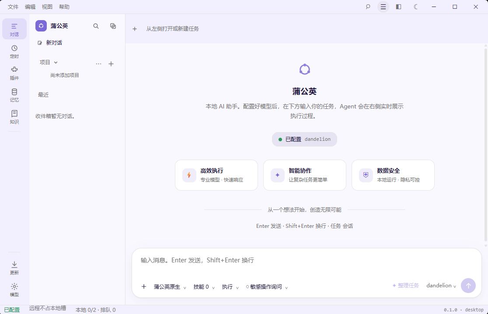
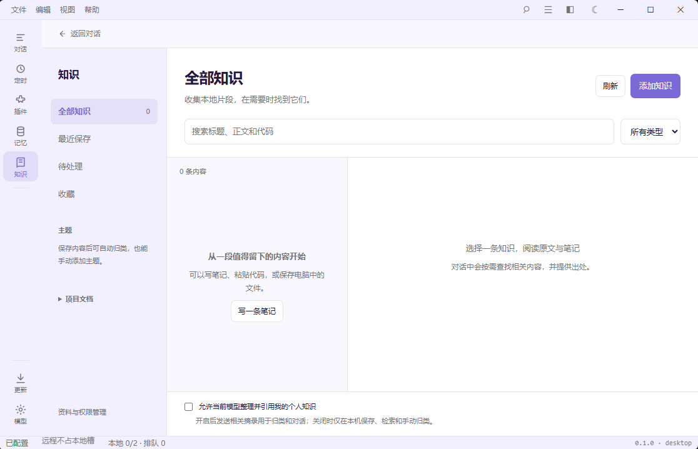
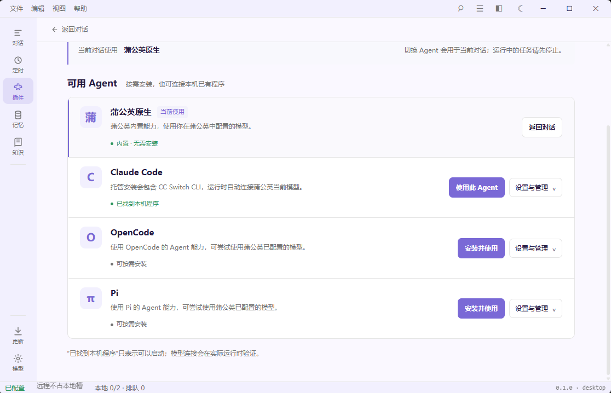

# Dandelion Open（蒲公英 · 开源版）

Dandelion Open 是本地优先的 AI Agent 桌面应用的**免登录开源版本**：启动直接进入主界面，无需注册、无需账号授权，所有功能立即可用。桌面端使用 Tauri 2、Vue 3；桌面端与 CLI 在进程内共用 Rust `dandelion-core` 的 Agent 运行时。模型可连接兼容 OpenAI API 的云端或本地服务。

## 首次使用

1. 从 [Releases](https://github.com/luoluopyq/dandelion-open/releases/latest) 下载安装包并安装，启动后直接进入主界面。
2. 打开 **设置 → 模型**，填写你的模型服务：Base URL、API Key（本地服务可留空）与模型名，兼容任意 OpenAI 格式接口（含 Ollama、vLLM 等本地服务）。
3. 回到主界面新建对话即可使用。除模型服务外没有其他联网依赖。

**更新**：设置 → 关于与更新 可检查 GitHub Releases 上的新版本；有新版本时会引导到 Release 页面下载安装包。开源版不分发更新签名私钥，因此不做应用内自动更新。

## 截图

| 主界面（启动直达，无需登录） | 知识库 | 插件（外部 Agent 免授权） |
| --- | --- | --- |
|  |  |  |

## 环境要求

- Rust stable（项目的 `rust-toolchain.toml`）
- Node.js 22 和 npm
- Windows：Microsoft C++ Build Tools 和 WebView2 Runtime
- macOS：Xcode Command Line Tools（`xcode-select --install`）

## 启动

在仓库根目录安装前端依赖，然后启动桌面端：

```bash
npm --prefix apps/desktop ci
npm --prefix apps/desktop run tauri dev
```

也可以直接运行 CLI：

```bash
cargo run -p dandelion-cli -- doctor
cargo run -p dandelion-cli -- chat
```

首次对话前，在桌面端配置模型，或为 CLI 设置 `DANDELION_BASE_URL`、`DANDELION_MODEL`；需要鉴权时再设置 `DANDELION_API_KEY`。例如连接本地兼容 OpenAI API 的服务：

```powershell
# Windows PowerShell
$env:DANDELION_BASE_URL = "http://127.0.0.1:11434/v1"
$env:DANDELION_MODEL = "your-model-id"
cargo run -p dandelion-cli -- chat
```

```bash
# macOS shell
export DANDELION_BASE_URL="http://127.0.0.1:11434/v1"
export DANDELION_MODEL="your-model-id"
cargo run -p dandelion-cli -- chat
```

需要独立安装 CLI 时运行 `cargo install --path crates/dandelion-cli --locked`，之后可直接使用 `dln doctor`、`dln chat`。

## Windows 打包

在 Windows 仓库根目录执行：

```powershell
npm --prefix apps/desktop ci
powershell -NoProfile -ExecutionPolicy Bypass -File scripts/build-installer.ps1
```

默认生成 NSIS 安装器：`target/release/bundle/nsis/Dandelion Open_<version>_x64-setup.exe`。也可以运行 `scripts/build-installer.cmd`；如需 MSI，给 PowerShell 脚本加 `-Bundler msi`。首次打包时，Tauri 可能下载 NSIS；MSI 另需 WiX。

## macOS 打包

在 Mac 的仓库根目录执行：

```bash
xcode-select --install
npm --prefix apps/desktop ci
bash scripts/build-installer.sh
```

默认生成兼容 Apple silicon 与 Intel 的安装镜像：`target/universal-apple-darwin/release/bundle/dmg/Dandelion Open_<version>_universal.dmg`。只打单一架构时，使用 `bash scripts/build-installer.sh arm64` 或 `bash scripts/build-installer.sh x64`。脚本会安装缺失的 Rust target。未签名的本地构建首次打开时可能需要在 Finder 中右键选择“打开”。

安装包必须在对应操作系统上构建；仓库的 `.github/workflows/release.yml` 可分别构建 Windows 和 macOS 产物。

## 许可

本仓库（Dandelion Open）采用 [Apache License 2.0](LICENSE)，是真正的开源许可：可自由使用、修改和分发，包括商业用途。第三方依赖及素材遵循各自的许可。

## 与商业版的区别

Dandelion Open 不含登录、注册、授权、套餐与订单等账号功能，也不需要任何账号服务：所有能力在本地解锁，唯一的联网需求是你自行配置的模型服务，以及检查更新时访问 GitHub Releases。
